<p align="center">
  
</p>

<h1 align="center">优课学习助手 · UOOC Helper</h1>

<p align="center">课程连播 · DeepSeek 辅助答题 · 课程与成绩总览 · 本机登录保持</p>

<p align="center">
  
  
  
</p>

面向优课 UOOC 与学习通的桌面浏览器扩展，提供视频连播、倍速、学习统计和课程成绩查看；优课支持 DeepSeek 辅助填写习题。原生 JavaScript 实现，无需安装 Node.js 或执行构建命令即可加载。

**2.1.4 弹题修正与保存后续播**：支持网站公布的 JSON 数组正确答案，例如 `["B"]`、`["A","C"]`；答错后修正选项、点击确定并续播；修复测验保存后停在旧页面、继续连播仍不跳转的问题。

**2.1.3 按钮优化**：顶部设置入口增加文字与醒目背景，删除密钥采用浅红描边及垃圾桶图标，操作逻辑保持不变。

**2.1.2 静态更新清单**：插件与助手改为直接读取更新清单，不再调用 GitHub REST API 查询版本。首次需手动升级 1.1.0 助手并授权下载域名。

**2.1.1 界面与稳定性优化**：统一登录保持、弹窗内更新与进度、分类设置、保存与草稿保护，完善更新失败恢复。

**2.1.0 稳定性与操作体验优化**：当前页面内继续答题、复用已核对答案、确认采用人工修改；网络有限重试、播放器启动超时及更明确的进度提示。不新增学习通答题适配。

**2.0.1 答题中断修复**：单题不确定、无效 JSON 或回答未完整结束时，重新请求当前题的最可能答案，标注推测答案后继续，不跳过该题。重试失败仍停止并保留已填写内容。

**2.0.0 学习通适配版**：接入章节多视频连播、倍速、定时停止、学习统计、独立成绩总览与登录保持开关。学习通可编辑章节测验尚缺真实样例，暂由人工作答和提交；课程与成绩已通过真实账号复测；真实连播与登录检测尚待反馈。原优课答题流程保留。

从 1.2.0 升级时增加了学习通站点访问范围，需要手动替换原目录、重新加载扩展并确认浏览器权限。更新后刷新课程页，面板应显示 **v2.1.4**。本机助手不会自动覆盖包含新增访问范围的版本。

> 本项目为非官方工具，与优课、学习通及 DeepSeek 无隶属关系。请遵守课程和平台的使用要求。模型可能答错，插件不会保证成绩、绕过闯关验证或伪造学习记录。

## 导航

[页面预览](#页面预览) · [功能概览](#功能概览) · [安装](#安装) · [DeepSeek 配置](#配置-deepseek) · [日常使用](#日常使用) · [答题恢复](#答题恢复与有限重试) · [登录保持](#登录保持) · [版本与更新](#版本与更新) · [课程与成绩](#课程完成度与成绩) · [数据与权限](#数据与权限) · [常见问题](#常见问题)

## 页面预览

以下截图由 **v2.1.3 源码**渲染，与 v2.1.4 的界面布局一致（本版仅调整弹题反馈与保存后切换逻辑），课程、成绩与登录状态均为模拟数据，不包含真实 API Key、Cookie 或个人信息。更新视图中的新版信息仅用于演示；窄屏展示不代表移动端浏览器支持安装扩展。

### 插件概览与版本更新

顶部带文字的“设置”入口、最近学习记录，以及无需跳转的更新视图。

<p align="center">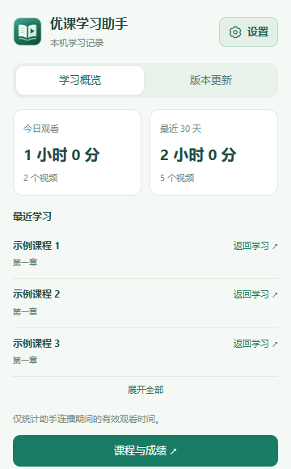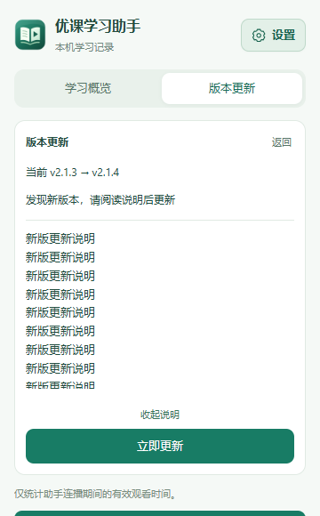</p>

### 学习通页面预览

当前学习通面板保留连播、倍速和定时，将低频操作收入“更多”；尚未支持的答题按钮不展示。

<p align="center">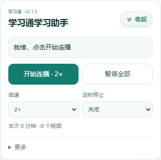</p>

章节任务点完成度、综合成绩及网站提供的分项指标：

<p align="center">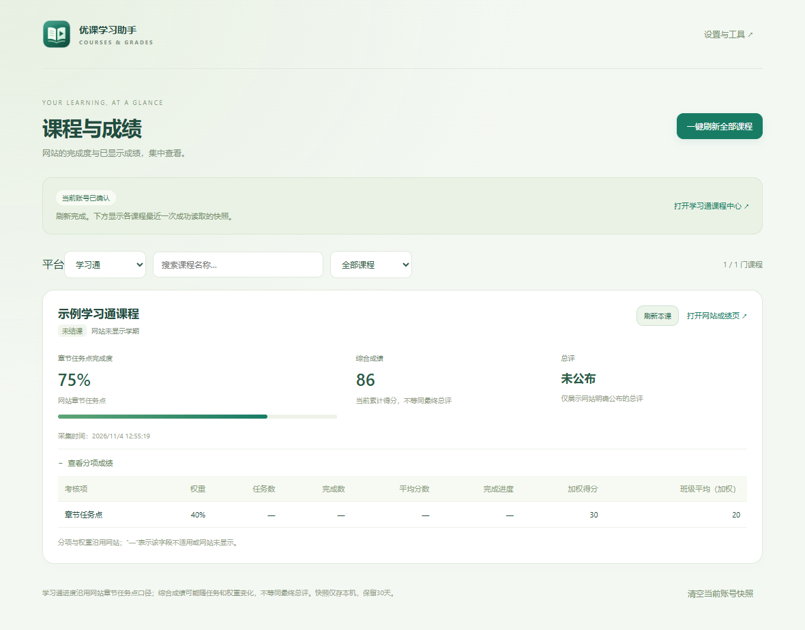</p>

### 优课 UOOC 页面预览

紧凑面板提供连播、暂停和手动答题，“更多”中可查看成绩、自动提交及诊断。收起后显示可拖动圆球。

<p align="center">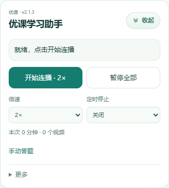</p>

视频＋测验完成度、当前得分和分项成绩：

<p align="center">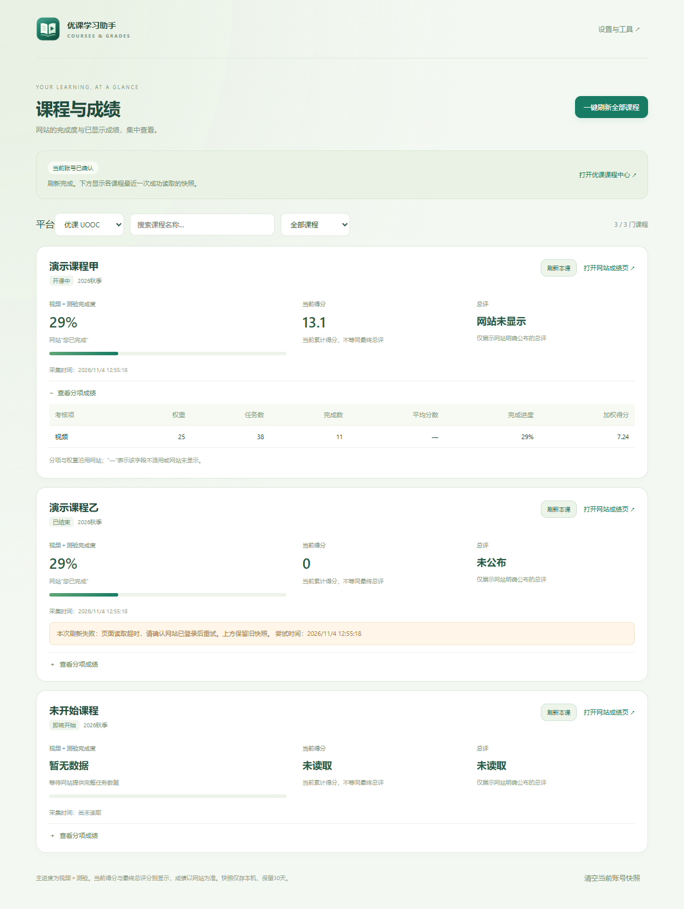</p>

### 分类设置与统一登录保持

设置分为常用设置、连接与账号、高级工具；两平台共用登录保持开关。“删除密钥”采用浅红描边及垃圾桶图标。

<p align="center">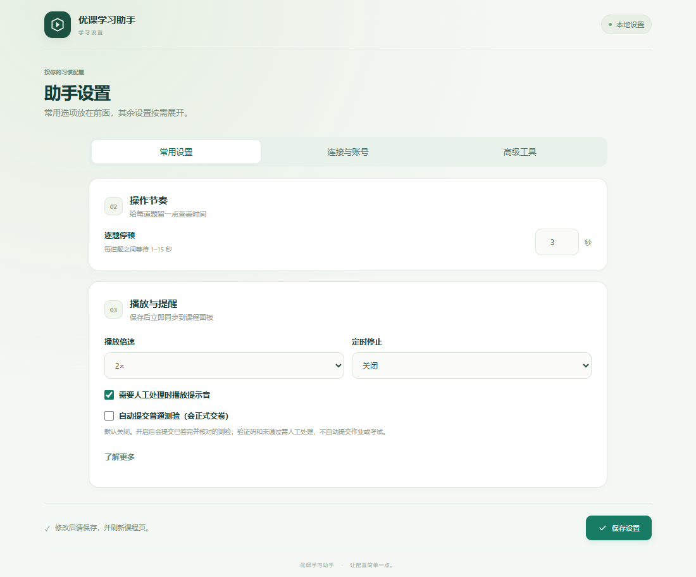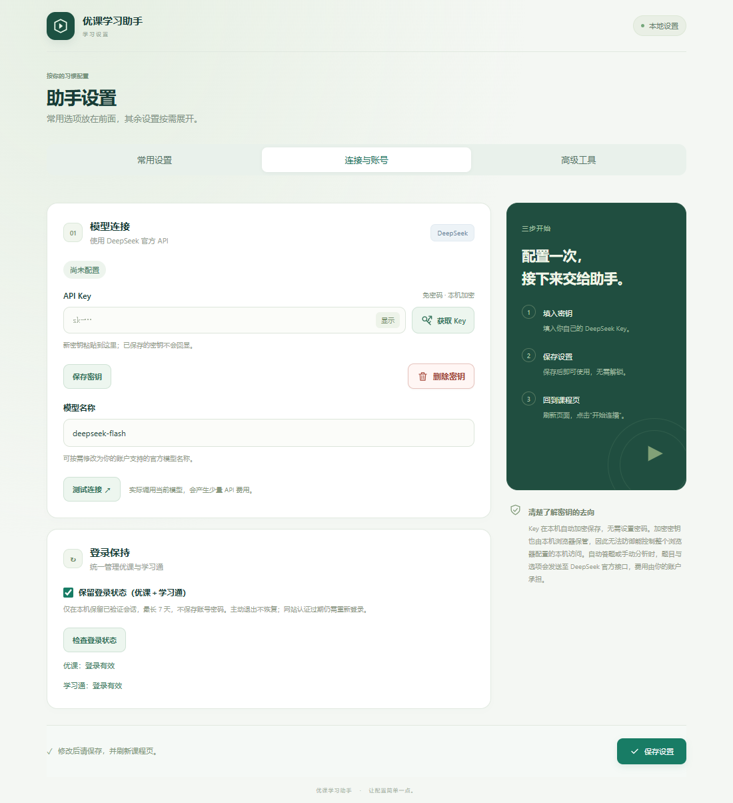</p>

<details><summary>查看窄屏与统一登录保持</summary>

<p align="center">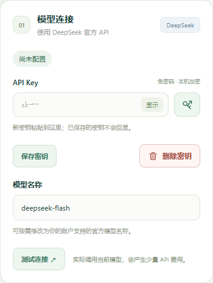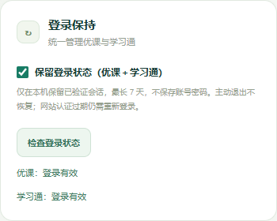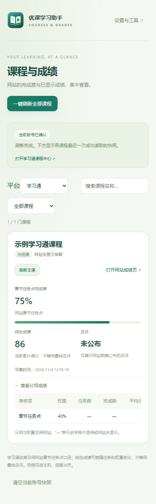</p>

</details>

### 版本与更新

更新来源固定为 [qiuxingya/uooc-helper Releases](https://github.com/qiuxingya/uooc-helper/releases)，不接受网页指定其他更新地址，不使用 Release 正文中的附件链接或 GitHub 自动生成的 Source code 包。

### 可选：首次启用 Windows 自动更新助手

1. 下载并解压 `uooc-helper-2.1.4.zip`，替换原插件目录，在扩展管理页重新加载。
2. 打开设置页“版本与更新”，展开“首次安装本机助手”，复制扩展 ID。
3. 下载并解压 `uooc-updater-windows.zip`，运行 `UoocUpdater.exe`。填写扩展 ID，选择浏览器当前实际加载、直接包含 manifest.json 的独立插件文件夹，再选择 Edge 或 Chrome，点击“关联并安装”。
4. 回到插件设置，点击“授权并连接本机助手”。确认显示关联目录后，即可使用“立即更新”。
5. 需要自动安装时开启对应开关；默认自动安装关闭。自动检查默认开启，但要先授权 GitHub 访问才会工作。

旧版 1.1.0 没有自更新代码，需要先手动升级。首次步骤完成后，后续兼容版本可通过更新中心安装；未安装本机助手时仍可手动替换插件目录。

### 手动与自动更新

- **手动检查**：查询仓库最新非草稿、非预发布的 Release，显示仓库版本和发布说明；找到更高版本后可手动安装。
- **自动检查**：每6小时检查一次，也会在浏览器启动时按检查间隔核对。可以单独关闭。
- **自动安装**：需本机助手已连接并主动开启；优课与学习通页面全部关闭、没有课程成绩扫描时安装。在下载过程中重新打开任一平台，会取消本次覆盖并延后。
- **安装与确认**：下载暂存后校验 GitHub SHA-256、ZIP结构、版本和扩展身份，保持原目录更新，再重新加载扩展。新版后台确认成功后清理旧备份；未确认或失败时恢复旧文件，浏览器异常时可能仍需手动重新加载或重开。
- **权限变化**：新版增加权限、访问范围或改变扩展身份时拒绝自动覆盖，需要查看发布说明后手动升级。
- **网络与限流**：失败时保留当前版本，GitHub限流会提示等待重试，不会拿不明确或缺少校验值的安装包强行安装。

本机助手不读取浏览器密码、Cookie或插件密钥，不设置开机服务；只允许明确关联的扩展ID访问。仅支持Windows上开发者模式加载的独立、可写解压目录，不修改商店安装、浏览器User Data、安全策略或包含.git的工作目录。更改安装目录后需要重新关联。SHA-256用于校验下载内容，更新仍基于对该GitHub仓库发布者的信任。

关闭自动安装可停止后续自动覆盖。再次运行安装器点击“解除关联”可移除本助手自己的浏览器注册项。详细说明见 [本机助手安装与管理](docs/updater-setup.md)。

### 发布者操作

上传与标签、manifest.json一致的 `uooc-helper-版本.zip`，例如标签 `v2.1.4` 对应 `uooc-helper-2.1.4.zip`。每次发新版本都递增版本号，不要覆盖同版本包；需要本机助手自动安装更新时，另外提供 `uooc-updater-windows.zip`。自 2.1.2 起必须同时上传 `update.json` 和 `SHA256SUMS.txt`，静态更新客户端依赖最新正式版中的清单附件。

完整GitHub源码包额外包含 `native-updater/`、`tools/build-release.ps1` 和 `.github/workflows/release.yml`。在允许脚本的Windows PowerShell环境可运行构建脚本生成两个 ZIP、静态清单 `update.json` 和 `SHA256SUMS.txt`。推送v开头标签或手动触发工作流会构建并创建Release草稿／附加安装包；检查附件后再发布，草稿不会被自动更新客户端选中。工作流需要仓库启用Actions，Release上传需要contents写权限。不要把GitHub源码包当作自动安装附件。

## 课程完成度与成绩

优课显示视频＋测验完成度和当前得分；学习通显示章节任务点完成度和综合成绩，展开后查看网站提供的分项指标。总评只在网站明确公布时显示。

<p align="center"></p>

### 密钥、播放与登录保持设置

Key 保存、连接测试、自动提交、登录保持和备份工具均可在设置页配置。

<details>
<summary>展开完整设置页截图</summary>

<p align="center"></p>

</details>

### 手动检查与自动更新

Windows 本机助手完成一次关联后，可在这里检查、手动安装或开启自动安装。优课页面仍打开时延后覆盖。

<p align="center">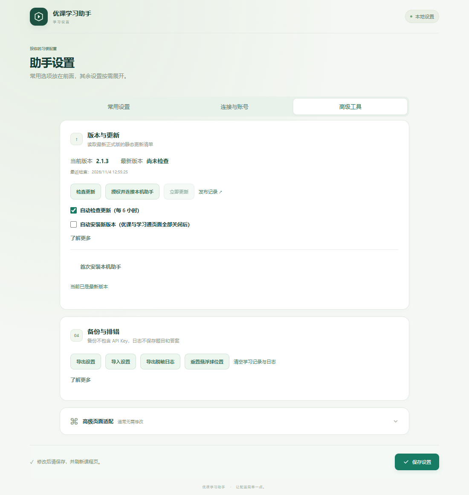</p>

### 工具栏学习概览

<p align="center"></p>

<details>
<summary>查看窄屏设置页与成绩页</summary>

窄屏截图用于展示响应式布局，不代表移动端浏览器已支持安装本扩展。

<p align="center"></p>
<p align="center">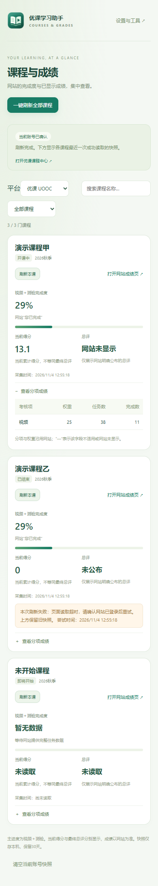</p>

</details>

## 平台支持范围

| 功能 | 优课 UOOC | 学习通 |
| --- | --- | --- |
| 连播、倍速、定时、观看统计 | 支持 | 已接入，真实连播待反馈 |
| 课程与成绩总览 | 视频＋测验、当前得分及分项 | 章节任务点、综合成绩及分项；真实账号刷新已通过 |
| 登录保持 | 统一开关，默认关闭 | 统一开关，默认关闭；真实登录检测待反馈 |
| DeepSeek 答题、视频弹题、保存及可选交卷 | 支持已适配题型 | 暂未开放，遇到测验请人工处理 |

学习通当前适配桌面网页的章节学习页。受限 iframe、学校验证、图片题、考试及特殊课程入口可能需要人工处理。

## 功能概览

| 功能 | 说明 |
| --- | --- |
| 视频连播 | 自动查找目录中的未完成资源，视频结束后继续后续小节或章节 |
| 倍速选择 | 支持 1×、1.25×、1.5×、1.75×、2×，默认 2× |
| AI 辅助答题 | 使用自己的 DeepSeek API，识别单选、多选、判断和填空题 |
| 视频弹题 | 识别播放中的习题弹窗，填写并确认后继续播放；忽略已移至视频下方的历史题目 |
| 保存后继续 | 默认保存答案后继续视频，交卷留待人工处理 |
| 可选自动交卷 | 主动开启后，对已确认的普通测验执行保存、提交确认和成功检测；默认关闭 |
| 目录恢复 | 跳过明确没有资源的空节点，遇到锁定章节时尝试后续可进入的章节 |
| 登录保持 | 按需授权，在本机保留有效会话型 Cookie，减少浏览器重开后重新登录的情况 |
| 课程与成绩 | 汇总已选课程的视频＋测验完成度、当前得分和网站公开的分项成绩 |
| 版本与更新 | 手动检查 GitHub 正式版；每6小时自动检查，关联 Windows 本机助手后可自动安装 |
| 学习统计 | 查看本次、今日、最近 30 天有效观看时间和播完次数，保留最近学习入口 |
| 定时停止 | 预设 15／30／60／120 分钟或自定义 1–240 分钟，默认关闭 |
| 悬浮面板 | 支持拖动、触屏操作和圆形收纳，保存本机位置 |
| 排错与备份 | 页面诊断、脱敏日志、设置导入导出和异常提示音 |

## 安装

适用于支持 Manifest V3 的桌面版 Edge 和 Chrome，当前自动化浏览器验证使用 Edge。Firefox、Safari 和移动端浏览器尚未验证。

1. 从 [v2.1.4 发布页](https://github.com/qiuxingya/uooc-helper/releases/tag/v2.1.4) 下载 `uooc-helper-2.1.4.zip` 并解压。插件单独安装即可使用，本机更新助手是可选组件。
2. 打开浏览器扩展管理页：Edge 为 `edge://extensions/`，Chrome 为 `chrome://extensions/`。
3. 开启“开发者模式”，选择“加载解压缩的扩展”。
4. 选择直接包含 [manifest.json](manifest.json) 的文件夹，**不要选择 ZIP 文件**。
5. 在优课课程网页刷新页面，即可看到右下角悬浮球。

如果下载的是完整工作目录，扩展源码位于 `outputs/uooc-helper/`；如果仓库仅包含扩展源码，则选择仓库根目录。判断依据始终是所选文件夹内能直接看到 `manifest.json`。

更新时尽量替换原安装目录中的文件，再在扩展管理页点击“重新加载”，最后刷新优课页面。更换目录、浏览器或重新安装可能改变扩展身份，导致原有本机密钥和设置无法沿用。

## 配置 DeepSeek

1. 在 [DeepSeek 开放平台](https://platform.deepseek.com/api_keys) 创建自己的 API Key，也可点击设置页输入框旁的“获取 Key”。
2. 打开扩展设置，粘贴 Key 并点击“保存密钥”。保存后不需要密码解锁，密钥不会回显。
3. 填写账户支持的模型名称，点击“保存设置”。密钥保存与普通设置保存是两个独立操作。
4. 可点击“测试连接”，确认当前 Key 与模型能够返回结果。

连接测试会实际调用当前模型，产生少量 API 费用。输入了新 Key 时使用该输入，留空时使用已保存的 Key；测试不会自动保存尚未保存的 Key 或模型设置。连接测试只发送固定简短文本，不携带课程题目。

### 密钥更换与旧版本迁移

- 更换 Key：在输入框粘贴新 Key，点击“更换密钥”；留空时，连接测试使用已保存的 Key。
- 删除 Key：使用设置页的“删除密钥”，尚未完成的请求会取消，迟到结果不会继续填入页面；已发出的请求仍可能计费。
- 旧版明文 Key：可点击“加密迁移密钥”。
- 0.8.0 的密码加密 Key：需重新粘贴一次 Key 并保存，成功前保留原密文；当前版本不需要设置密码或解锁。

## 日常使用

1. 登录优课或学习通，打开需要学习的课程章节页。
2. 点击右下角悬浮球，选择倍速和定时选项。
3. 点击“开始连播”。助手根据当前目录打开视频；优课可处理已适配习题，学习通遇到测验时交由人工处理。
4. 随时点击“暂停全部”停止后续操作。收起面板不会暂停运行。

页面刷新后不会自动开始学习，需要再次点击“开始连播”。

### 常用操作与默认值

| 项目 | 默认值／操作 |
| --- | --- |
| 悬浮面板 | 初始收纳为圆形按钮，点击展开；“收起”或 Esc 可收纳 |
| 悬浮球拖动 | 鼠标或触屏移动超过 6 像素视为拖动，拖动结束不展开；位置保存在本机 |
| 播放倍速 | 2×，运行中修改立即作用于当前及后续视频 |
| 逐题停顿 | 3 秒，可在设置页调整为 1–15 秒 |
| 定时停止 | 关闭，每轮开始时重新计时 |
| 自动提交普通测验 | 关闭 |
| 登录保持 | 关闭，首次开启需要按需授权 |
| 异常提示音 | 开启，主动暂停不鸣响 |

窗口大小改变时，悬浮球和面板会限制在可见区域。若拖动位置不合适，可在设置页点击“重置悬浮球位置”。

### 答题、保存与交卷

默认流程：

```text
进入习题 → 调用模型 → 填写并检查填入结果 → 保存答案 → 继续后续资源
```

如需自动交卷，在面板或设置页开启“自动提交普通测验（会正式交卷）”：

```text
填写并检查填入结果 → 保存 → 打开提交确认 → 确认交卷
                                      ↓
                              网站明确返回成功后续播
```

- 自动交卷默认关闭，仅处理能够确认的普通测验，不自动提交作业或考试。
- 完整性与填入结果检查不代表答案内容一定正确。
- 遇到验证码、未答完、未通过、按钮不唯一或提交结果不明确时暂停，交由人工处理；不因等待结果而重复交卷。
- “分析并填写”只填写答案，不执行自动交卷。
- 暂停或关闭自动交卷开关不能撤回已经发出的提交；已发出的模型请求也可能计费。

### 空小节与闯关限制

对于明确显示“点击下方继续学习”等空资源提示的目录节点，助手会等待提示稳定、确认没有加载动画后继续查找后续资源。加载中的页面和网络错误不会按空小节跳过。

遇到闯关或锁定入口，会尝试后续可进入的章节；如果后续章节全部受限，则停止并显示原因。插件不会解除网站锁定，也不会自动返回补做已跳过的章节。

### 定时停止与提示音

到点会暂停视频，取消本标签页尚未完成的模型请求，阻止后续填写、保存、确认和章节切换；已填写到页面的内容保留。手动暂停会结束本轮倒计时，再次开始会重新计时。运行中修改定时，在下次开始时生效。

浏览器或系统休眠时无法保证准时执行，恢复后会检查截止时间。异常提示音默认开启，可在设置页关闭；浏览器限制声音时仍显示文字提示。

## 登录保持

用于减少浏览器重开后的重复登录。优课与学习通使用一个“保留登录状态”开关，默认关闭；分别显示登录检测结果。升级前两个平台设置不同则显示半选状态，用户操作后统一，不擅自开启。

1. 打开设置，勾选“保留登录状态（优课＋学习通）”。
2. 允许浏览器申请的 Cookie 与对应站点访问权限。
3. 当前登录已经失效时，先在该平台完成一次登录或学校验证。
4. 点击“检查登录状态”，确认显示“登录有效”。

登录保持只处理已通过网站页面或接口验证的已知登录会话 Cookie。会话型 Cookie 在本机保留 7 天，保留原有域名、路径、HttpOnly、Secure 和 SameSite 属性；网站原本已经设置到期时间的 Cookie 不延长。不处理无痕或分区 Cookie。

浏览器启动时会检查；打开对应平台期间每 15 分钟只读检查一次。Cookie 内容只保留在浏览器自身的 Cookie 存储中，不复制到扩展存储、同步或备份，也不发送至 DeepSeek。

主动退出或清理 Cookie 后，不恢复旧登录。关闭开关会将仍由插件管理的 Cookie 恢复为会话型，不立即退出网站。服务器失效、学校单点登录规则和浏览器“退出时清理 Cookie”等设置仍可能要求重新登录，因此不保证永久免登录。请仅在自己的电脑开启。

## 课程完成度与成绩

点击工具栏扩展图标中的“课程与成绩”，或从课程面板进入独立总览页，选择“优课 UOOC”或“学习通”再刷新。

- 支持课程名称搜索、状态筛选、刷新单课和刷新全部课程。
- 优课进度采用“视频＋测验”口径；学习通沿用网站“章节任务点”完成度，可能包含视频、音频及测验，不重复累加测验数量。数据不足或分母为零时显示“暂无数据”。
- 优课“当前得分”、学习通“综合成绩”均沿用网站名称，不当作最终总评。学习通分项的“我的成绩”已加权，不再次乘权重；零分、未公布、未读取和读取失败分别显示。
- 展开课程可查看网站提供的签到、视频、作业、测验、讨论、考试及教师调分等分项。

刷新会创建一个临时后台标签页，依次读取已选课程及成绩；支持取消，单门失败不影响后续课程。刷新不播放视频、不填写或提交习题，只清理扩展自己创建的临时页。

成绩快照按账号与平台课程标识隔离（优课为开课批次，学习通为课程＋班级），仅存本机并保留最近 30 天。未确认当前账号时隐藏旧缓存。成绩不发送至 DeepSeek，也不进入设置备份或脱敏日志。

## 学习统计、诊断与备份

- 本次统计在悬浮面板显示；今日、最近 30 天统计和最近 10 门课程的位置在工具栏弹窗显示。
- 有效观看时长按实际经过时间计算，暂停、缓冲和播放位置没有前进时不计时。同课程多标签页的重叠时长合并；已完成视频按课程、资源与日期去重，无法可靠识别的资源只计本次次数。
- 约每 10 秒批量保存，在暂停和视频结束时补记。刷新保留已保存记录，异常关闭最多损失最近未写入的一批。
- “返回学习”打开课程入口，不自动改写播放器进度，需要自行点击开始。
- “检查页面”显示适配版本、可访问 iframe 数、视频数、识别题型数、保存／确认按钮数及停止原因代码，可复制诊断；不抓取整页 HTML。
- 设置页可导出脱敏日志、导入导出设置，以及清空本机学习记录与日志。清空后若仍在连播，会继续产生新记录。
- 设置备份导入时先校验格式、版本、类型、范围与 CSS 选择器，再预览变更；点击“应用导入”后整体保存，非法文件不会部分覆盖。

### 高级页面适配

设置页默认折叠高级适配，提供题目容器、题干和下一节入口三个 CSS 选择器。通常保持留空，优先使用内置的新旧版目录与同域习题识别。只有确定页面结构时再填写；选择器有误或入口不唯一时需人工检查。

## 数据与权限

| 数据或权限 | 用途与保存方式 |
| --- | --- |
| API Key | AES-256-GCM 本机加密；不可导出的加密密钥保存在扩展 IndexedDB，不同步到浏览器账号 |
| 题目与选项 | 答题时发送至 DeepSeek 官方 API；填空题同时发送空格数量 |
| 一般设置 | 在扩展中保存，部分设置通过浏览器同步存储同步 |
| 学习记录与成绩 | 本机保留最近 30 天，不上传至项目服务器 |
| 脱敏日志 | 最近 30 天、最多 1000 条；记录阶段和固定错误代码，不保存题目、答案、模型解析、Key 或请求头 |
| `storage` | 保存设置、密钥密文、统计、成绩快照和必要的状态元数据 |
| `alarms` | 定时停止、成绩扫描超时和已启用的登录保持检查 |
| DeepSeek 站点访问 | 后台调用 `https://api.deepseek.com/` |
| 优课与学习通内容脚本 | 识别已适配课程页面，扫描页仅执行读取与必要导航 |
| 可选 GitHub 访问 | 只读检查公开 Release；不发送 Key、成绩、Cookie 或课程内容 |
| 可选 nativeMessaging 与课程页面状态访问 | 连接本机更新助手，在所有优课与学习通页面关闭后才覆盖文件 |
| 可选 Cookie 与对应平台访问 | 开启对应登录保持时申请；处理已知会话 Cookie 并只读检测登录 |

本机自动加密不等同于密码保险箱，无法防止能够访问整个浏览器配置的攻击者。项目不要求提供课程平台账号密码。

设置备份只包含倍速、逐题停顿、定时、提示音、自动提交开关和页面选择器，不包含 API Key、加密密钥、Cookie、登录保持开关、学习记录、成绩或当前运行状态。导入限制为 64 KB，校验成功后先预览，确认后整体应用。

## 答题恢复与有限重试

- **继续答题**：暂停或错误后点击继续，核对题目及页面答案，已正确写入且仍一致的题目不重复请求模型。断点只存在当前页面，刷新或关闭后清除，不新增题目或答案的持久存储。
- **保留人工修改**：修改过的完整答案需要点击“采用页面答案并继续”；未确认前不覆盖。答案不完整时先在页面补全；题干或选项变化会废弃对应旧结果并重新分析。
- **不确定也作答**：仍对当前题最多请求一次推测答案，日志标注推测，校验答案类型、数量与选项范围后再填写，不跳过当前题。
- **有限网络重试**：网络异常、25秒超时或服务器故障等待3秒后最多重试一次，与推测请求共用该额度，每题本轮最多三次模型请求。连接测试不自动重试。
- **限流等待**：优先按有效的 Retry-After 等待；超过60秒或再次失败就暂停。密钥无效、余额不足、模型不可用不自动重试。
- **费用提示**：重发可能再次计费，面板显示等待倒计时；主动暂停、定时到点或页面变化会取消后续操作，已经发出的请求仍可能产生费用。
- **视频启动**：单次启动最长等待20秒；同一资源的临时启动中断最多重试一次，自动播放被浏览器拒绝时提示点击播放器。不会把加载失败的视频标记为完成或擅自跳过。
- **明确进度**：面板显示已填写／总题数、当前题、推测数、重试数及具体停止原因；暂停后可继续答题或继续连播，继续连播重新计时。

推测答案不保证正确。默认自动提交关闭；开启后仍按原有条件正式交卷，保存、交卷前会重新核对整份试卷。缺题或页面变化时不会直接提交。

### 最新版紧凑面板

最新面板见上方双平台预览；发生中断时按提示选择继续答题或继续连播。


## 暂停与人工处理

以下情况可能暂停并显示原因：未配置 Key、网络或模型接口重试耗尽、推测重试仍失败、题目加载不完整、题型或控件不支持、保存／确认入口不唯一、保存或提交未收到明确成功提示、目录加载失败、考试或验证码。单次模型不确定不会立即终止整份试卷，处理方式见上方说明。

单空和多空题支持普通文字／数字输入框，以及能够识别为填空题的 textarea，按页面顺序填写。富文本编辑器、图片空格、特殊自绘控件和跨域习题可能需要人工处理。

对于视频弹题，如果网站在同一区域明确给出正确／参考答案，助手会尝试据此修正选择题后再次确认；无法识别反馈、选项已锁定或仍未通过时暂停。不会更改网站的判题规则，也不保证所有课程反馈格式兼容。

网站可能限制倍速或采用自己的学习进度计算规则，插件显示的本地统计不等同于平台认定的完成度。

## 常见问题

**没有看到悬浮球？**

确认扩展已启用、当前页面属于已支持的优课或学习通章节学习页，并在更新扩展后刷新课程页面。可在设置页重置悬浮球位置。

**视频停住或不自动播放？**

先手动播放一次再点击“开始连播”，并检查是否有习题弹窗、验证码、网络错误或网站访问限制。可使用“检查页面”复制诊断结果。

**填完题却没有交卷？**

默认只保存答案。需要交卷时手动处理，或主动开启自动提交开关。保存不等于完成测验，网站可能仍要求验证或达到通过分数。

**开启登录保持后还是需要登录？**

先确认已授权并显示“登录有效”。当前已经失效的会话无法恢复；服务器过期、学校认证和浏览器退出清理 Cookie 等策略也可能使其失效。

**统计和网站进度不一致？**

本地统计只记录助手连播期间的实际有效观看时间，2×观看 10 分钟计为 10 分钟。网站进度、完成标记和成绩以平台为准。

**连接测试失败？**

检查 Key、余额、模型名称、限流和网络状态。不要将完整 Key、Cookie 或请求头粘贴到 Issue 中。

## 源码结构

以下为扩展源码文件夹内的主要文件：

```text
uooc-helper/
├── manifest.json       # MV3 配置与权限
├── background.js       # 模型请求、密钥管理和消息权限
├── settings.js         # 设置校验与备份格式
├── content.js          # 悬浮面板、连播、题目识别与填写
├── platforms.js         # 平台 URL 校验、课程身份与学习记录地址
├── uooc-adapter.js      # 优课新旧版课程目录适配
├── chaoxing-adapter.js  # 学习通章节与多视频队列
├── chaoxing-parser.js   # 学习通课程与成绩 DOM 解析
├── chaoxing-reader.js   # 扫描页导航与稳定读取
├── chaoxing-grades.js   # 学习通成绩队列和账号隔离
├── chaoxing-account.js  # 账号变更失效提示
├── chaoxing-login.js    # 独立学习通会话保持
├── chaoxing-options.js  # 学习通登录设置界面
├── quiz-submit.js       # 普通测验提交确认与结果检测
├── updater.js           # 版本检测、自动检查与本机更新协作
├── update-options.js    # 更新设置界面
├── login-session.js     # 登录检测与本机会话保持
├── activity.js          # 学习统计、计时和脱敏日志
├── course-parser.js     # 课程及成绩页面解析
├── course-reader.js     # 只读扫描页面适配
├── grades-worker.js     # 成绩刷新队列与账号隔离
├── grades.*             # 课程与成绩总览
├── options.*            # 设置页
├── popup.*              # 工具栏弹窗
└── icons/               # 扩展图标
```

配置入口见 [manifest.json](manifest.json)，历史实现细节与分版本验证记录见 [使用说明](使用说明.md)。

## 更新生效检查

1. 先处理尚未保存的答案，再用新版文件替换扩展原安装目录。
2. 在扩展管理页点击“重新加载”，随后刷新课程页面；仅下载 ZIP 或仅刷新网页不一定能更新已安装的副本。
3. 展开悬浮面板，确认顶部版本为 **v2.1.4**。
4. 如果仍显示旧版，检查扩展实际加载目录，不要同时开启多个助手副本。

## 验证范围与反馈

已使用独立 Edge 测试配置验证连播、题目填写、保存、提交确认、定时取消、统计、设置导入导出、成绩解析，本机会话跨浏览器重启保留和退出后不恢复，以及本机助手更新后的扩展重载和数据保留。模型响应和登录集成测试使用模拟接口，没有以这些测试代替真实课程记分或实际账号长期会话验证。

学习通成绩刷新已通过真实账号复测，真实连播与登录检测尚待反馈；独立 Edge 模拟会话已验证跨重启保留及退出后不恢复。网站升级、特殊课程、跨域习题和未知题型可能需要进一步适配。主观题、复杂图片题、考试及验证码保留人工处理。

提交问题时，建议附上插件版本、浏览器版本、出现问题的操作步骤和脱敏诊断。截图请遮挡姓名、学号和其他个人信息，不要上传 API Key、Cookie、请求头或整个浏览器配置目录。

## 更新记录

| 版本 | 主要变化 |
| --- | --- |
| [2.1.4](https://github.com/qiuxingya/uooc-helper/releases/tag/v2.1.4) | 修复视频弹题 JSON 数组反馈解析，以及测验保存后切换卡住；支持原入口有限重试、暂停后继续，避免重复答题保存 |
| [2.1.3](https://github.com/qiuxingya/uooc-helper/releases/tag/v2.1.3) | 设置入口增加文字、图标和绿色背景；删除密钥改为浅红描边与垃圾桶图标，保留确认流程；沿用助手 1.1.0，不新增权限 |
| [2.1.2](https://github.com/qiuxingya/uooc-helper/releases/tag/v2.1.2) | 插件与助手改用静态 update.json，不再通过 GitHub REST API 查询版本；助手升级至 1.1.0，首次需手动迁移与下载域名授权；保留校验和回滚 |
| 2.1.1 | 精简界面、统一登录开关、弹窗内更新与恢复、保存一致性和草稿保护 |
| 2.1.0 | 页面内断点恢复、人工修改确认、有限网络重试、播放器启动超时与进度提示 |
| 2.0.1 | 单题不确定时重试最可能答案并继续，日志标注推测，保留格式校验与暂停取消 |
| 2.0.0 | 学习通连播、统计、独立成绩及登录保持；修复课程列表和账号复核超时，测验暂人工处理 |
| 1.2.0 | GitHub手动／自动检查、Windows本机助手自动安装、校验与回滚 |
| 1.1.0 | 按需授权的本机登录保持、官方接口登录检测与状态提示 |
| 1.0.1 | 空资源节点与资源选择占位页恢复，加载状态保护 |
| 1.0.0 | 闯关后续章节尝试、可选普通测验自动交卷 |
| 0.10.0 | 课程完成度与成绩总览 |
| 0.9.0 | 拖动悬浮球、倍速、定时、学习统计、诊断与备份 |
| 0.8.1 | 免密码的 API Key 本机加密保存 |

本版 2.1.4 见 [弹题修正验证记录](docs/validation-2.1.4.md)；2.1.3 见 [按钮与界面验证记录](docs/validation-2.1.3.md)；静态更新方案见 [2.1.2 验证记录](docs/validation-2.1.2.md)；2.1.1 见 [界面与恢复验证记录](docs/validation-2.1.1.md)；2.1.0 的测试范围见 [验证记录](docs/validation-2.1.0.md)；2.0.1 历史修复见 [此前验证记录](docs/validation-2.0.1.md)；学习通此前的测试范围与待确认项见 [2.0.0 验证记录](docs/validation-2.0.0.md)。

## 开发与验证

本仓库根目录是唯一维护与发布来源，不再从历史的 outputs/uooc-helper 或临时暂存目录取源码。

使用 Node.js 24 与桌面 Edge，运行 `npm install --ignore-scripts` 安装测试依赖，再运行 `npm test`。测试使用独立模拟页面与接口，不使用真实账号、真实 Key 或付费请求；截图写入已忽略的 `.test-artifacts/`。GitHub Actions 的稳定性回归使用同一入口。

打包运行 `./tools/build-release.ps1 -RepositoryRoot . -OutDirectory dist -ReleaseTag v2.1.4`，生成插件 ZIP、独立 Windows 本机助手 ZIP、`update.json` 与 `SHA256SUMS.txt`。安装时选择解压后的独立插件目录，不使用含 `.git` 的开发仓库作为本机助手的更新目录。

### 弹窗内更新

点击浏览器右上角插件图标，再点“版本更新”，直接检查正式 Release、展示更新说明，点击“立即更新”即可安装，无需跳转设置页。首次仍需安装并关联本机助手。弹窗显示下载校验、安装、重新加载阶段；助手尚不提供下载字节数，因此下载阶段使用不定进度条。关闭弹窗不取消后台安装，重新打开可查看状态。

### 2.1.1 保存与更新恢复

普通设置显示未修改、未保存、保存中、已保存和失败状态；保存期间继续编辑会保留新草稿。模型名称与普通设置一次写入本机，云同步失败单独提示。未保存密钥会定位到连接分类，离开时由浏览器提示。导入设置不会把未保存模型误标为已保存。

更新先读取后台状态，安装中禁止重复操作；旧轮询不会覆盖失败提示。校验失败需重新检查，助手未连接可前往设置，课程页未关闭时需手动关闭后重试。仅新版完成确认后显示更新成功，等待确认不代表成功。

## 2.1.2 静态更新清单

插件与本机助手改为读取最新正式版中的 update.json，日常查询不再消耗 GitHub REST API 匿名额度。仍依赖 GitHub 网络，保留缓存、SHA-256 校验与回滚；未增加数字签名。

首次请手动升级插件与 1.1.0 助手、重新关联，并授权 GitHub 下载域名。之后可继续在插件弹窗内检查和更新。发布时必须提供 update.json；缺失时提示手动升级，不回退 API。详见 RELEASE_NOTES.md。

### 2.1.3 按钮预览（模拟数据）

<p></p>
