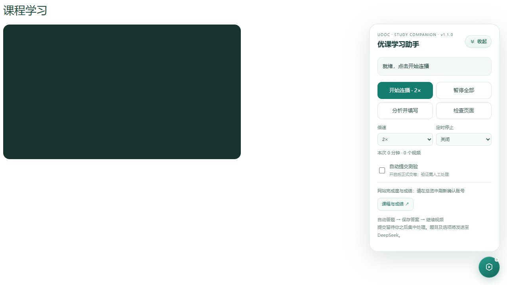
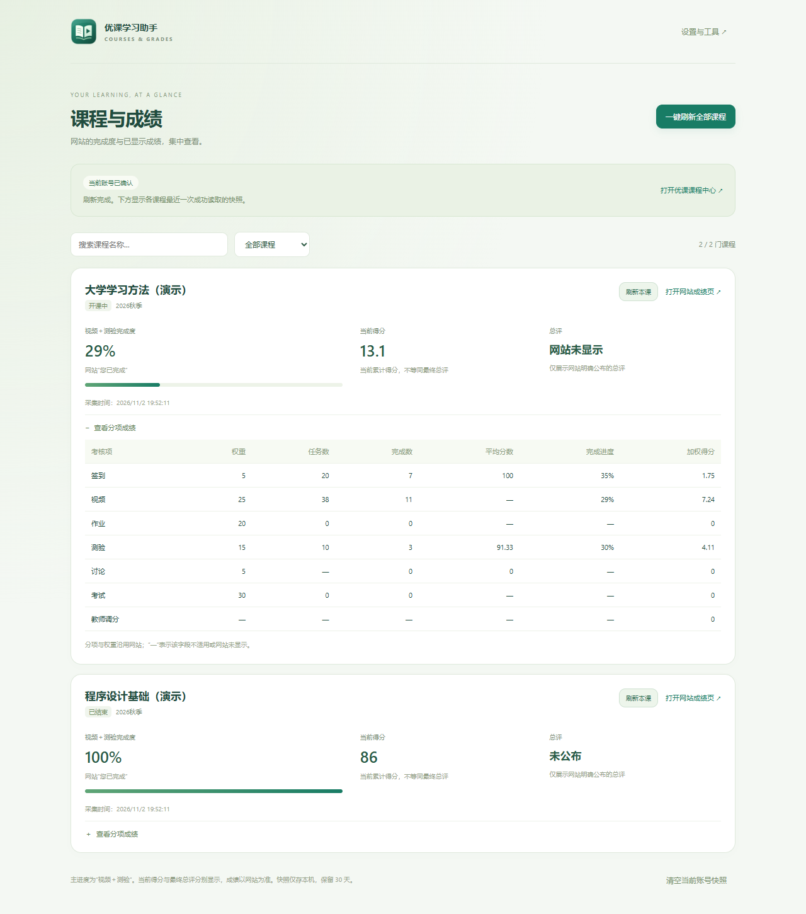
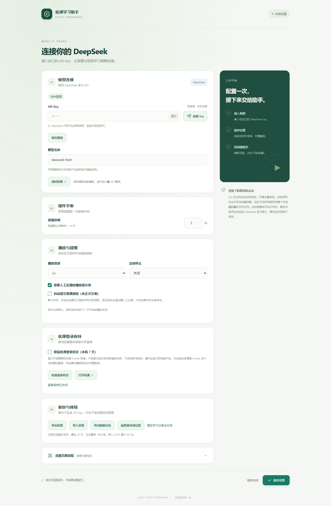
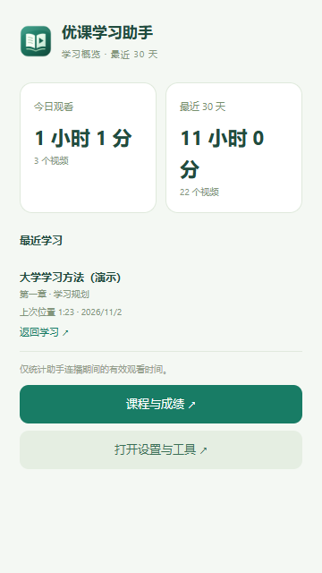
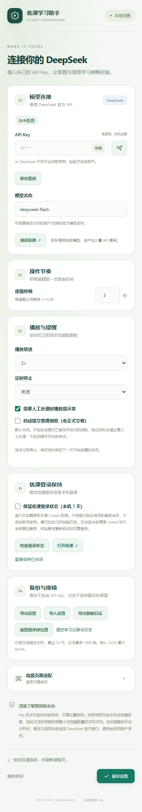
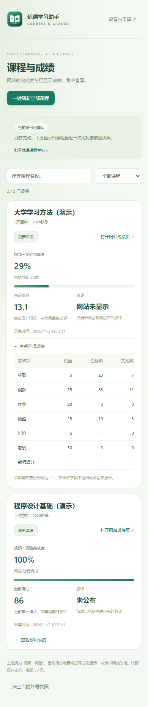

<p align="center">
  
</p>

<h1 align="center">优课学习助手 · UOOC Helper</h1>

<p align="center">课程连播 · DeepSeek 辅助答题 · 课程与成绩总览 · 本机登录保持</p>

<p align="center">
  
  
  
</p>

面向优课 UOOC 的桌面浏览器扩展，提供视频连播、倍速、DeepSeek 辅助填写习题、学习统计和课程成绩查看。原生 JavaScript 实现，无需安装 Node.js 或执行构建命令即可加载。

> 本项目为非官方工具，与优课及 DeepSeek 无隶属关系。请遵守课程和平台的使用要求。模型可能答错，插件不会保证成绩、绕过闯关验证或伪造学习记录。

## 导航

[页面预览](#页面预览) · [功能概览](#功能概览) · [安装](#安装) · [DeepSeek 配置](#配置-deepseek) · [日常使用](#日常使用) · [登录保持](#登录保持) · [课程与成绩](#课程完成度与成绩) · [数据与权限](#数据与权限) · [常见问题](#常见问题)

## 页面预览

以下截图来自 **1.1.0 插件实际页面与独立测试页面**。课程、成绩、时长和最近位置均为演示数据，不代表真实课程记分；API Key 输入框未配置真实密钥。

### 课程悬浮面板

倍速、定时、自动提交开关和课程总览入口集中在面板中，收起后以圆形悬浮球显示。

<p align="center"></p>

<details>
<summary>查看收纳后的悬浮球</summary>

<p align="center"></p>

</details>

### 课程完成度与成绩

统一查看视频＋测验完成度、当前得分和网站公布的总评，展开后查看分项指标。

<p align="center"></p>

### 密钥、播放与登录保持设置

Key 保存、连接测试、自动提交、登录保持和备份工具均可在设置页配置。

<details>
<summary>展开完整设置页截图</summary>

<p align="center"></p>

</details>

### 工具栏学习概览

<p align="center"></p>

<details>
<summary>查看窄屏设置页与成绩页</summary>

窄屏截图用于展示响应式布局，不代表移动端浏览器已支持安装本扩展。

<p align="center"></p>
<p align="center"></p>

</details>

## 功能概览

| 功能 | 说明 |
| --- | --- |
| 视频连播 | 自动查找目录中的未完成资源，视频结束后继续后续小节或章节 |
| 倍速选择 | 支持 1×、1.25×、1.5×、1.75×、2×，默认 2× |
| AI 辅助答题 | 使用自己的 DeepSeek API，识别单选、多选、判断和填空题 |
| 视频弹题 | 识别播放中的习题弹窗，填写并确认后继续播放；忽略已移至视频下方的历史题目 |
| 保存后继续 | 默认保存答案后继续视频，交卷留待人工处理 |
| 可选自动交卷 | 主动开启后，对已确认的普通测验执行保存、提交确认和成功检测；默认关闭 |
| 目录恢复 | 跳过明确没有资源的空节点，遇到锁定章节时尝试后续可进入的章节 |
| 登录保持 | 按需授权，在本机保留有效会话型 Cookie，减少浏览器重开后重新登录的情况 |
| 课程与成绩 | 汇总已选课程的视频＋测验完成度、当前得分和网站公开的分项成绩 |
| 学习统计 | 查看本次、今日、最近 30 天有效观看时间和播完次数，保留最近学习入口 |
| 定时停止 | 预设 15／30／60／120 分钟或自定义 1–240 分钟，默认关闭 |
| 悬浮面板 | 支持拖动、触屏操作和圆形收纳，保存本机位置 |
| 排错与备份 | 页面诊断、脱敏日志、设置导入导出和异常提示音 |

## 安装

适用于支持 Manifest V3 的桌面版 Edge 和 Chrome，当前自动化浏览器验证使用 Edge。Firefox、Safari 和移动端浏览器尚未验证。

1. 下载仓库源码 ZIP 并解压；如果维护者提供了 Release 安装包，也可解压该安装包。
2. 打开浏览器扩展管理页：Edge 为 `edge://extensions/`，Chrome 为 `chrome://extensions/`。
3. 开启“开发者模式”，选择“加载解压缩的扩展”。
4. 选择直接包含 [manifest.json](manifest.json) 的文件夹，**不要选择 ZIP 文件**。
5. 在优课课程网页刷新页面，即可看到右下角悬浮球。

如果下载的是完整工作目录，扩展源码位于 `outputs/uooc-helper/`；如果仓库仅包含扩展源码，则选择仓库根目录。判断依据始终是所选文件夹内能直接看到 `manifest.json`。

更新时尽量替换原安装目录中的文件，再在扩展管理页点击“重新加载”，最后刷新优课页面。更换目录、浏览器或重新安装可能改变扩展身份，导致原有本机密钥和设置无法沿用。

## 配置 DeepSeek

1. 在 [DeepSeek 开放平台](https://platform.deepseek.com/api_keys) 创建自己的 API Key，也可点击设置页输入框旁的“获取 Key”。
2. 打开扩展设置，粘贴 Key 并点击“保存密钥”。保存后不需要密码解锁，密钥不会回显。
3. 填写账户支持的模型名称，点击“保存设置”。密钥保存与普通设置保存是两个独立操作。
4. 可点击“测试连接”，确认当前 Key 与模型能够返回结果。

连接测试会实际调用当前模型，产生少量 API 费用。输入了新 Key 时使用该输入，留空时使用已保存的 Key；测试不会自动保存尚未保存的 Key 或模型设置。连接测试只发送固定简短文本，不携带课程题目。

### 密钥更换与旧版本迁移

- 更换 Key：在输入框粘贴新 Key，点击“更换密钥”；留空时，连接测试使用已保存的 Key。
- 删除 Key：使用设置页的“删除密钥”，尚未完成的请求会取消，迟到结果不会继续填入页面；已发出的请求仍可能计费。
- 旧版明文 Key：可点击“加密迁移密钥”。
- 0.8.0 的密码加密 Key：需重新粘贴一次 Key 并保存，成功前保留原密文；当前版本不需要设置密码或解锁。

## 日常使用

1. 登录优课，打开需要学习的课程。
2. 点击右下角悬浮球，选择倍速和定时选项。
3. 点击“开始连播”。助手根据当前目录打开视频，并处理能够识别的习题。
4. 随时点击“暂停全部”停止后续操作。收起面板不会暂停运行。

页面刷新后不会自动开始学习，需要再次点击“开始连播”。

### 常用操作与默认值

| 项目 | 默认值／操作 |
| --- | --- |
| 悬浮面板 | 初始收纳为圆形按钮，点击展开；“收起”或 Esc 可收纳 |
| 悬浮球拖动 | 鼠标或触屏移动超过 6 像素视为拖动，拖动结束不展开；位置保存在本机 |
| 播放倍速 | 2×，运行中修改立即作用于当前及后续视频 |
| 逐题停顿 | 3 秒，可在设置页调整为 1–15 秒 |
| 定时停止 | 关闭，每轮开始时重新计时 |
| 自动提交普通测验 | 关闭 |
| 登录保持 | 关闭，首次开启需要按需授权 |
| 异常提示音 | 开启，主动暂停不鸣响 |

窗口大小改变时，悬浮球和面板会限制在可见区域。若拖动位置不合适，可在设置页点击“重置悬浮球位置”。

### 答题、保存与交卷

默认流程：

```text
进入习题 → 调用模型 → 填写并检查填入结果 → 保存答案 → 继续后续资源
```

如需自动交卷，在面板或设置页开启“自动提交普通测验（会正式交卷）”：

```text
填写并检查填入结果 → 保存 → 打开提交确认 → 确认交卷
                                      ↓
                              网站明确返回成功后续播
```

- 自动交卷默认关闭，仅处理能够确认的普通测验，不自动提交作业或考试。
- 完整性与填入结果检查不代表答案内容一定正确。
- 遇到验证码、未答完、未通过、按钮不唯一或提交结果不明确时暂停，交由人工处理；不因等待结果而重复交卷。
- “分析并填写”只填写答案，不执行自动交卷。
- 暂停或关闭自动交卷开关不能撤回已经发出的提交；已发出的模型请求也可能计费。

### 空小节与闯关限制

对于明确显示“点击下方继续学习”等空资源提示的目录节点，助手会等待提示稳定、确认没有加载动画后继续查找后续资源。加载中的页面和网络错误不会按空小节跳过。

遇到闯关或锁定入口，会尝试后续可进入的章节；如果后续章节全部受限，则停止并显示原因。插件不会解除网站锁定，也不会自动返回补做已跳过的章节。

### 定时停止与提示音

到点会暂停视频，取消本标签页尚未完成的模型请求，阻止后续填写、保存、确认和章节切换；已填写到页面的内容保留。手动暂停会结束本轮倒计时，再次开始会重新计时。运行中修改定时，在下次开始时生效。

浏览器或系统休眠时无法保证准时执行，恢复后会检查截止时间。异常提示音默认开启，可在设置页关闭；浏览器限制声音时仍显示文字提示。

## 登录保持

用于减少“关闭浏览器后，再次进入优课必须手动登录”的情况，**默认关闭**。

1. 打开设置，勾选“保留优课登录状态（本机 7 天）”。
2. 允许浏览器弹出的 Cookie 与优课站点访问权限。
3. 当前登录已经失效时，先在优课完成一次登录或学校／微信验证。
4. 点击“检查登录状态”，确认显示“登录有效”。之后可正常关闭并重开浏览器。

登录保持只处理已通过网站接口验证的已知登录会话 Cookie。会话型 Cookie 在本机保留 7 天，保留原有域名、路径、HttpOnly、Secure 和 SameSite 属性；网站原本已经设置到期时间的 Cookie 不延长。不处理无痕或分区 Cookie。

浏览器启动时会检查；打开优课期间每 15 分钟只读检查一次。Cookie 内容只保留在浏览器自身的 Cookie 存储中，不复制到扩展存储、同步或备份，也不发送至 DeepSeek。

主动退出或清理 Cookie 后，不恢复旧登录。关闭开关会将仍由插件管理的 Cookie 恢复为会话型，不立即退出网站。服务器失效、学校单点登录规则和浏览器“退出时清理 Cookie”等设置仍可能要求重新登录，因此不保证永久免登录。请仅在自己的电脑开启。

## 课程完成度与成绩

点击工具栏扩展图标中的“课程与成绩”，或从课程面板进入独立总览页。

- 支持课程名称搜索、状态筛选、刷新单课和刷新全部课程。
- 主进度采用“视频＋测验”口径，优先读取网站“您已完成”；缺失时根据相应任务数计算并注明来源，数据不足时显示“暂无数据”。
- “当前得分”沿用网站名称，只有网站明确公布最终总评时才展示“总评”。零分、未公布、未读取和读取失败分别显示。
- 展开课程可查看网站提供的签到、视频、作业、测验、讨论、考试及教师调分等分项。

刷新会创建一个临时后台标签页，依次读取已选课程及成绩；支持取消，单门失败不影响后续课程。刷新不播放视频、不填写或提交习题，只清理扩展自己创建的临时页。

成绩快照按账号和课程开课批次隔离，仅存本机并保留最近 30 天。未确认当前账号时隐藏旧缓存。成绩不发送至 DeepSeek，也不进入设置备份或脱敏日志。

## 学习统计、诊断与备份

- 本次统计在悬浮面板显示；今日、最近 30 天统计和最近 10 门课程的位置在工具栏弹窗显示。
- 有效观看时长按实际经过时间计算，暂停、缓冲和播放位置没有前进时不计时。同课程多标签页的重叠时长合并；已完成视频按课程、资源与日期去重，无法可靠识别的资源只计本次次数。
- 约每 10 秒批量保存，在暂停和视频结束时补记。刷新保留已保存记录，异常关闭最多损失最近未写入的一批。
- “返回学习”打开课程入口，不自动改写播放器进度，需要自行点击开始。
- “检查页面”显示适配版本、可访问 iframe 数、视频数、识别题型数、保存／确认按钮数及停止原因代码，可复制诊断；不抓取整页 HTML。
- 设置页可导出脱敏日志、导入导出设置，以及清空本机学习记录与日志。清空后若仍在连播，会继续产生新记录。
- 设置备份导入时先校验格式、版本、类型、范围与 CSS 选择器，再预览变更；点击“应用导入”后整体保存，非法文件不会部分覆盖。

### 高级页面适配

设置页默认折叠高级适配，提供题目容器、题干和下一节入口三个 CSS 选择器。通常保持留空，优先使用内置的新旧版目录与同域习题识别。只有确定页面结构时再填写；选择器有误或入口不唯一时需人工检查。

## 数据与权限

| 数据或权限 | 用途与保存方式 |
| --- | --- |
| API Key | AES-256-GCM 本机加密；不可导出的加密密钥保存在扩展 IndexedDB，不同步到浏览器账号 |
| 题目与选项 | 答题时发送至 DeepSeek 官方 API；填空题同时发送空格数量 |
| 一般设置 | 在扩展中保存，部分设置通过浏览器同步存储同步 |
| 学习记录与成绩 | 本机保留最近 30 天，不上传至项目服务器 |
| 脱敏日志 | 最近 30 天、最多 1000 条；记录阶段和固定错误代码，不保存题目、答案、模型解析、Key 或请求头 |
| `storage` | 保存设置、密钥密文、统计、成绩快照和必要的状态元数据 |
| `alarms` | 定时停止、成绩扫描超时和已启用的登录保持检查 |
| DeepSeek 站点访问 | 后台调用 `https://api.deepseek.com/` |
| 优课内容脚本 | 识别和操作匹配优课域名的课程页面 |
| 可选 Cookie 与优课后台访问 | 仅开启登录保持时申请；处理已知登录 Cookie 并只读检测会话 |

本机自动加密不等同于密码保险箱，无法防止能够访问整个浏览器配置的攻击者。项目不要求提供优课账号密码。

设置备份只包含倍速、逐题停顿、定时、提示音、自动提交开关和页面选择器，不包含 API Key、加密密钥、Cookie、登录保持开关、学习记录、成绩或当前运行状态。导入限制为 64 KB，校验成功后先预览，确认后整体应用。

## 暂停与人工处理

以下情况可能暂停并显示原因：未配置 Key、模型调用失败、模型返回不确定答案、题目加载不完整、题型或控件不支持、保存／确认入口不唯一、保存或提交未收到明确成功提示、目录加载失败、考试或验证码。

单空和多空题支持普通文字／数字输入框，以及能够识别为填空题的 textarea，按页面顺序填写。富文本编辑器、图片空格、特殊自绘控件和跨域习题可能需要人工处理。

对于视频弹题，如果网站在同一区域明确给出正确／参考答案，助手会尝试据此修正选择题后再次确认；无法识别反馈、选项已锁定或仍未通过时暂停。不会更改网站的判题规则，也不保证所有课程反馈格式兼容。

网站可能限制倍速或采用自己的学习进度计算规则，插件显示的本地统计不等同于平台认定的完成度。

## 常见问题

**没有看到悬浮球？**

确认扩展已启用、当前页面属于优课域名，并在更新扩展后刷新课程页面。可在设置页重置悬浮球位置。

**视频停住或不自动播放？**

先手动播放一次再点击“开始连播”，并检查是否有习题弹窗、验证码、网络错误或网站访问限制。可使用“检查页面”复制诊断结果。

**填完题却没有交卷？**

默认只保存答案。需要交卷时手动处理，或主动开启自动提交开关。保存不等于完成测验，网站可能仍要求验证或达到通过分数。

**开启登录保持后还是需要登录？**

先确认已授权并显示“登录有效”。当前已经失效的会话无法恢复；服务器过期、学校认证和浏览器退出清理 Cookie 等策略也可能使其失效。

**统计和网站进度不一致？**

本地统计只记录助手连播期间的实际有效观看时间，2×观看 10 分钟计为 10 分钟。网站进度、完成标记和成绩以平台为准。

**连接测试失败？**

检查 Key、余额、模型名称、限流和网络状态。不要将完整 Key、Cookie 或请求头粘贴到 Issue 中。

## 源码结构

以下为扩展源码文件夹内的主要文件：

```text
uooc-helper/
├── manifest.json       # MV3 配置与权限
├── background.js       # 模型请求、密钥管理和消息权限
├── settings.js         # 设置校验与备份格式
├── content.js          # 悬浮面板、连播、题目识别与填写
├── uooc-adapter.js      # 新旧版课程目录适配
├── quiz-submit.js       # 普通测验提交确认与结果检测
├── login-session.js     # 登录检测与本机会话保持
├── activity.js          # 学习统计、计时和脱敏日志
├── course-parser.js     # 课程及成绩页面解析
├── course-reader.js     # 只读扫描页面适配
├── grades-worker.js     # 成绩刷新队列与账号隔离
├── grades.*             # 课程与成绩总览
├── options.*            # 设置页
├── popup.*              # 工具栏弹窗
└── icons/               # 扩展图标
```

配置入口见 [manifest.json](manifest.json)，历史实现细节与分版本验证记录见 [使用说明](使用说明.md)。

## 更新生效检查

1. 先处理尚未保存的答案，再用新版文件替换扩展原安装目录。
2. 在扩展管理页点击“重新加载”，随后刷新优课课程页面；仅下载 ZIP 或仅刷新网页不一定能更新已安装的副本。
3. 展开悬浮面板，确认顶部版本为 **v1.1.0**。
4. 如果仍显示旧版，检查扩展实际加载目录，不要同时开启多个助手副本。

## 验证范围与反馈

已使用独立 Edge 测试配置验证连播、题目填写、保存、提交确认、定时取消、统计、设置导入导出、成绩解析，以及本机会话跨浏览器重启保留和退出后不恢复。模型响应和登录集成测试使用模拟接口，没有以这些测试代替真实课程记分或实际账号长期会话验证。

登录保持的真实账号跨重启验收尚待完成；网站升级、特殊课程、跨域习题和未知题型可能需要进一步适配。主观题、复杂图片题、考试及验证码保留人工处理。

提交问题时，建议附上插件版本、浏览器版本、出现问题的操作步骤和脱敏诊断。截图请遮挡姓名、学号和其他个人信息，不要上传 API Key、Cookie、请求头或整个浏览器配置目录。

## 更新记录

| 版本 | 主要变化 |
| --- | --- |
| 1.1.0 | 按需授权的本机登录保持、官方接口登录检测与状态提示 |
| 1.0.1 | 空资源节点与资源选择占位页恢复，加载状态保护 |
| 1.0.0 | 闯关后续章节尝试、可选普通测验自动交卷 |
| 0.10.0 | 课程完成度与成绩总览 |
| 0.9.0 | 拖动悬浮球、倍速、定时、学习统计、诊断与备份 |
| 0.8.1 | 免密码的 API Key 本机加密保存 |
